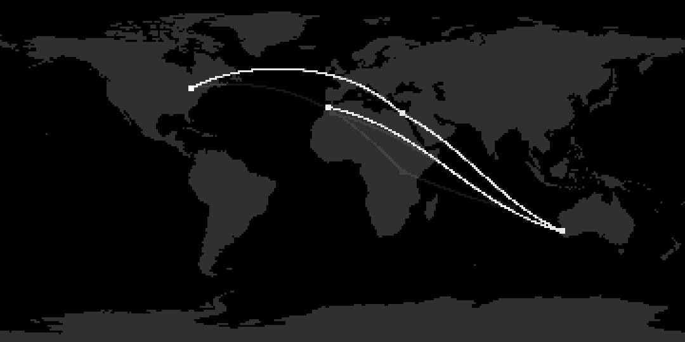

# The Kestrel Chase: a class composite activity

A class activity for a data science lab. A courier known as Kestrel takes a
vaccine seed strain from a laboratory in Toronto and makes three hops around
the world. The class follows the route from evidence. Each hop needs a
different technique:

| Hop | Evidence | Technique | Student function |
|---|---|---|---|
| 1 | Daily sunrise and sunset times (UTC) | Inverting a physical model | `fit_daylight(log)` |
| 2 | Location pings, about 30% of them wrong | Robust estimation | `locate_from_pings(pings)` |
| 3 | Distances to four radio relays | Nonlinear least squares | `trilaterate(relays)` |

Each function returns `(lat, lon)`. Kestrel and the story are original to
this activity.

**The evidence is distributed, and the route is shared.** Each evidence file
is a dealt partition (`docs/datasets-course-library.md` §4.11): every student
holds a different part, and every part locates the same three cities. A
student whose functions pass adds a copy of the route to the class map. The
map is a `classComposite` with the `sum` compositor (`docs/class-composite.md`).
Correct routes add up to one bright line. A wrong estimate is a faint stray
line beside it, which gives the class something to discuss.



The image above sums 21 correct contributions and two that used the naive
methods (the plain mean of the pings, the centre of the relays). It is made
by the same code that the `sum` compositor runs.

## Files

| File | Role | Students see it |
|---|---|---|
| `starter.ipynb` | Starter notebook | yes |
| `solution.ipynb` | Solution notebook. Its function cells are `reference_solution.py`. | no |
| `chase_helpers.py` | Support file: the solar model, distances, the evidence readers, the gazetteer, `report()` and `plot_world()` | yes |
| `chase_grading.py` | Support file for the tests: tolerances, the footer, the route image. It holds no answers. | yes |
| `cities.csv` | Support file: the gazetteer of 66 cities | yes |
| `world_land.txt` | Support file: the base map, 180 lines of 360 characters | yes |
| `publictest_hop1_daylight.py`, `publictest_hop2_pings.py`, `publictest_hop3_relays.py` | One test for each hop | yes |
| `publictest_route_map.py` | Runs all three hops and sends the composite contribution | yes |
| `secrettest_decoy_case.py` | Runs all three hops on a different route, so a function that returns a memorized city fails | yes, as a script |
| `generate_case.py` | Instructor tool: writes the evidence and the keys from a seed | no |
| `check_case.py` | Instructor tool: checks a generated case before class | no |
| `make_land_map.py` | Instructor tool: rebuilds `world_land.txt` from Natural Earth | no |
| `reference_solution.py` | The reference functions, used by `check_case.py` | no |

`generate_case.py` writes these files, which are not in the repository:

| File | Role |
|---|---|
| `daylight_log.csv`, `pings.csv`, `relays.csv` | Course library datasets, each attached as a dealt partition |
| `route_key.json` | Grader-only: the class route |
| `decoy_daylight_log.csv`, `decoy_pings.csv`, `decoy_relays.csv`, `decoy_key.json` | Grader-only: the decoy route |
| `practice_daylight_log.csv`, `practice_pings.csv`, `practice_relays.csv`, `practice_key.json` | Support files: a practice route, with its answers |

## Before class

The seed decides the route, and this repository is public. Choose a private
seed and do not commit the generated files. Set `--slots` to the number of
composite slots, which is also the part count of each partition. Size it for
the expected attendance (`docs/class-composite.md` §"Slot count"); 24 is a
lab section. A second round of dealing covers a larger class.

From this folder, with numpy, pandas and scipy installed:

```bash
python3 -I generate_case.py case --seed 4417 --slots 24
```

```bash
python3 -I check_case.py case
```

`check_case.py` runs the reference solution on every part of each case and
prints the worst error against each tolerance. It also checks that the naive
methods fail in every part. It exits 1 if either check fails; if it does,
choose another seed. Across seeds 1 to 40 with 24 parts, the worst errors were
30.5 km for hop 1 (tolerance 100), 2.5 km for hop 2 (tolerance 25) and 8.7 km
for hop 3 (tolerance 30).

## Setting up the assignment

1. **Create a Python assignment, graded on the worker.** The keys are
   grader-only files, and Chickadee refuses grader-only files on a
   browser-graded assignment, because the browser would receive them. The
   runner image has numpy, pandas, scipy and matplotlib.
2. **Add the three evidence files to the course library** and attach each to
   the assignment as a dealt partition, with `partCount` equal to `--slots`.
   Keep their file names; the tests read them by name. A dealt part follows
   the composite slot, so a student's evidence and slot agree.
3. **Add the support files:** `chase_helpers.py`, `chase_grading.py`,
   `cities.csv`, `world_land.txt` and the four `practice_*` files. Mark
   `route_key.json` and the four `decoy_*` files grader-only.
4. **Add the five test scripts.** The four `publictest_*` scripts are in the
   public tier and `secrettest_decoy_case.py` is in the secret tier. A
   suggested weighting is 2 points for each hop, 1 for the route map and 1
   for the decoy case.
5. **Make it a class composite** on the edit page ("Class activity") or with
   MCP `set_activity`:

   ```json
   "activity": {
     "kind": "classComposite",
     "composite": {
       "compositor": "sum",
       "layout": { "count": 24 },
       "contribution": { "w": 360, "h": 180, "frames": 1, "format": "gray8" },
       "dealOrder": "random",
       "frameRate": 1,
       "showFailed": true,
       "emptySlots": "blank"
     }
   }
   ```

   One contribution is 64,800 bytes, inside the 64 KB cap. The limit of
   4 MB for all slots allows up to 61 slots. `emptySlots: reference` is
   refused for `sum`, and no reference render is needed.
6. **Upload `starter.ipynb` and `solution.ipynb`** and run validation.

## Design notes

- **Why one route for the whole class.** The `sum` compositor scales the
  brightest pixel of the total to 255. If each student had a different route,
  every crossing of two routes would be the brightest pixel and every other
  route would dim. With one route, correct contributions coincide, and only
  wrong ones fall elsewhere, at a fraction of the brightness.
- **Why the decoy.** A student who learns the three cities from a classmate
  can return them as constants and pass the public tests. The decoy test
  runs the same functions on evidence from another route. Its shortResult
  is never shown to students.
- **The route image shows the student's own estimates.** A wrong hop is
  drawn where the student put it, and the later hops start from there. The
  route follows great circles, which curve on an equirectangular map; the
  starter notebook asks why.
- **Hop 1 needs a readable latitude.** Day length says little near the
  equator or near an equinox. The generator picks a first city between 25
  and 60 degrees from the equator and dates from May to August.
- **Each part locates its city alone.** A part has 5 days of daylight, 40
  pings and 4 relays. The generator rejects a part in which the plain mean of
  the pings or the centre of the relays would pass.
- **The notebook runs when the tests import it.** Its check cells call the
  hop functions through `report()`, which prints an error instead of raising
  one, so an unfinished hop does not stop the tests of the other hops.
- **The base map** is Natural Earth's 1:110m land (public domain),
  rasterized by `make_land_map.py`.
